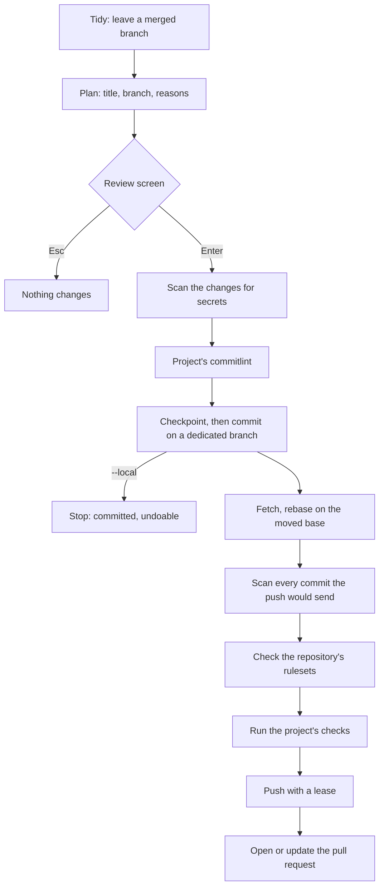

# How a delivery works

What happens, in order, when you run `ship`. Each step either passes or stops with a message that says what to do; nothing reaches GitHub until every check before the push has passed.

## On your machine

1. **Tidy.** If your branch's pull request was merged, ship goes back to the updated base first, with your work in progress (`ship tidy`). `ship.tidy.auto` turns this off, `ship.tidy.deleteMerged` keeps the merged branches.
2. **Plan.** ship reads the changed files and proposes a title, a branch name and the reasons for its choices. No AI and no network are involved. `ship plan` stops here.
3. **Review.** You correct the title, the branch, the why and the testing notes, or pick the files to deliver. Without a terminal, ship stops (exit code 2) unless you pass `--yes`.
4. **Secret scan.** The changes are scanned for secrets. A finding stops the delivery before anything is committed, and the values are masked in the message.
5. **Commit rules.** When the project has a commitlint configuration, ship adapts the title to it and runs the project's own commitlint on the message.
6. **Checkpoint and commit.** ship snapshots your files, creates a branch when you are on the default branch, and commits. It signs off the commit when the repository asks for it, and signs it as git or `ship.commits.sign` says. From here, `ship undo` reverts everything (see [the safety net](safety-net.md)). `ship --local` stops here.

## Before the push

The commit is instant; by default the slower checks run before publishing, so a red check leaves the commit local and undoable. A repository can ask for them before every commit instead (`ship.gates.beforeCommit`), and `ship check gates` runs them at any time.

7. **Token and base.** ship asks GitHub for the repository first: this proves the token works before anything is sent. It never pushes to the default branch. The base is the default branch, or `ship.pullRequest.base`; in a fork, the parent's.
8. **Rebase.** ship fetches the remote (`ship.git.remote`, `origin` by default), and when the base moved, takes a checkpoint and rebases your branch on it. With `ship.publish.update` it merges the base instead, or leaves the branch as it is. It does not rebase over commits someone else pushed to your branch. On a conflict it cancels the rebase, publishes as it is, and tells you how to resolve it.
9. **Second secret scan.** Every commit the push would send is scanned, including commits made outside ship, with `git commit` or an editor.
10. **Rulesets.** ship reads the repository's GitHub rulesets: commit message, e-mail and signature rules are checked now, because the push would fail anyway. A branch that ship created and that breaks a branch name rule is renamed to fit.
11. **Checks.** The project's own checks run, cheapest first: formatters, linters, then tests ([gates](../reference/gates.md)). Per-path overrides apply here, so a documentation-only change can skip them.

## On GitHub

12. **Conflicts seen early.** ship reads the open pull requests into the same base and warns (`SHIP-W0619`) when one changes the same or adjacent lines as your branch: whoever merges second will likely get a conflict, so you can talk to its author now. It never stops the push; `ship.publish.overlaps` turns it off.
13. **Push.** After a rebase, the push uses a lease: it fails rather than overwrite work it has not seen. A fork's branch goes to the fork.
14. **Pull request.** ship opens the pull request, or updates the one already open. The body is filled from facts: your why, a summary of the diff, the checks that passed, the linked issue; the repository's template is followed ([conventions](../reference/conventions.md)). With `--yes` it is a draft (`ship.pullRequest.draft` changes that), and from an AI agent always. A new pull request also gets the reviewers, assignee and milestone the [settings](../reference/configuration.md#pull-requests-and-github) ask for. In a fork, it opens on the parent.

`ship status` then follows the checks and the reviews and tells you the next step.
