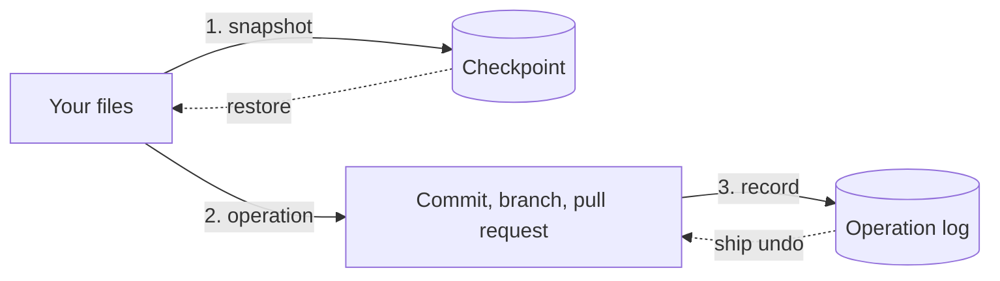

# The safety net: checkpoints and the operation log

ship lets you try things because it can take them back. This page explains how: what it records, where, and what it can and cannot revert.

## Two records

Before an operation changes anything, ship writes two things.

- A **checkpoint**: an invisible snapshot of your whole working tree, including the files git does not track yet.
- An entry in the **operation log**: what the operation did (the branch it created, the commit, the pull request, the issues) and which checkpoint came before it.



`ship undo` reads the log, reverts the last operation that can be undone, and appends an *undo* entry. The log is append-only: nothing in it is edited or deleted, so `ship log` always tells the full story.

## Where they live

Everything stays on your machine, inside your repository's `.git` folder:

| What | Where | Why there |
|---|---|---|
| Checkpoints | `.git/ship/store.git`, a private repository | Its refs never show in `git log --all` or in git tools, `git push --mirror` cannot send them, and your own `git gc` cannot remove them. |
| Operation log | `.git/ship/oplog/`, one JSON file per operation | Readable, and easy to audit. |

Nothing is pushed, and nothing leaves your machine. Checkpoints are byte-exact: line-ending settings and `.gitattributes` cannot change what comes back.

## Local and remote undo

Local effects (a commit, a branch, a changed configuration file) are reverted directly.

Effects on GitHub cannot be erased, only compensated:

- a pull request is closed, with a comment, and its branch deleted;
- the issue that pull request closes gets back its status in the GitHub Project, and loses the assignee ship added, unless someone changed the status since: ship then keeps it and tells you;
- issues created by `ship roadmap sync` are closed as *not planned*, never deleted;
- an issue's earlier state comes back, and sub-issue links are removed.

Because they are visible to other people, ship asks you to confirm remote compensations first. AI agents working through MCP may not undo a publication at all.

## What cannot be undone

- A **merged** pull request: the work is part of `main`, and other people may already build on it. Revert it with a new change that teammates review.
- Something you did **outside ship**, such as a `git commit` you typed yourself. ship records only its own operations.
- A `ship sync` of labels: it is recorded for audit, not reverted.

## Restoring a checkpoint by hand

`ship undo` covers almost every case. To go back to an older state of your files, `ship rewind` lists the recent checkpoints with the files that changed in each, and asks which one:

```sh
ship rewind                     # pick from the list
ship rewind 3 --yes             # the third newest, without asking
ship checkpoint --label before-experiment
```

Before writing anything, ship takes a checkpoint of your current files and shows exactly which files go back, so `ship undo` right after a rewind returns to where you were. Files created after the chosen checkpoint are left untouched. `ship checkpoint list` and `ship checkpoint restore <id>` do the same by id.

## Cleaning up

`ship gc` removes old checkpoints. It always keeps the 20 newest, the newest of each day for the last 30 days, and every checkpoint that an operation still undoable needs (ADR-0005). `ship gc --dry-run` shows what it would remove.
